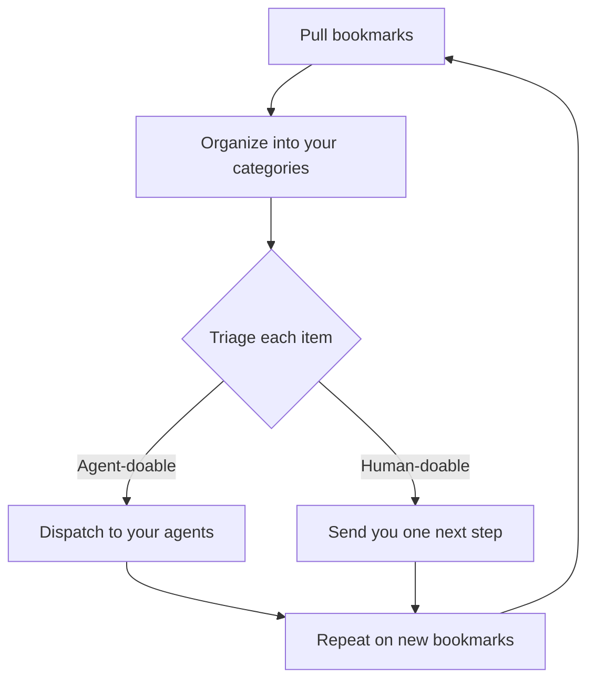

# Turn your bookmarks into action

This kit runs a repeating cycle: pull your bookmarks, organize them into your own categories, triage each item as human-doable or agent-doable, dispatch the agent-doable items to your agents, and send you one next step for the rest. Optional content skills can plan posts, check a draft, and record what worked. The next run handles new bookmarks.



**Do not commit `~/bookmark-library/` or the private files inside it to this repo or to a public fork.** That folder holds your bookmarks, your library, your agents, and your reports.

## Quick start

```bash
git clone https://github.com/ashwinmenon1995/Xbookmark-skills-library.git
cd Xbookmark-skills-library
mkdir -p ~/bookmark-library
```

Paste one prompt into your agent.

Claude Code, from this directory:

```text
Read AGENT.md in this repo and run the bookmark cycle on my bookmarks. Write private files only in ~/bookmark-library/. Do not commit them.
```

Codex, started in this directory:

```text
Read AGENT.md in this repo and run the bookmark cycle on my bookmarks. Write private files only in ~/bookmark-library/. Do not commit them.
```

Cursor, with this folder open, in Agent chat:

```text
Read AGENT.md in this repo and run the bookmark cycle on my bookmarks. Write private files only in ~/bookmark-library/. Do not commit them.
```

Grok, or another agent, after you paste `AGENT.md` into the chat:

```text
Run the bookmark cycle in the instructions I pasted on my bookmarks. Write private files only in ~/bookmark-library/. Do not commit them.
```

The first run is interactive. The agent will ask you to accept category names. Later runs can be scheduled.

## Load in your agent

Each skill is `skills/<name>/SKILL.md`. `name` matches the folder. `description` says when to use it.

- **Claude Code.** Copy the `skills/` folders into `.claude/skills/` in this project, or into `~/.claude/skills/`.
- **Codex.** Tell Codex to follow `AGENT.md`, or add that instruction to the project's `AGENTS.md`.
- **Cursor.** Add a project rule under `.cursor/rules` that says to follow `AGENT.md` and the skill files.
- **Grok and others.** Paste `AGENT.md` into the chat, then say: run this on my bookmarks.

To run one skill, name its file. For example: run `skills/post-draft-check/SKILL.md` on this draft.

## Schedule

Do not schedule until the first interactive run has finished and you have said yes. The scheduled prompt is the same one as the quick start. Do not print bookmark text into a public log.

- **cron and a headless agent CLI.** A weekly cron line runs your agent's non-interactive command with the quick-start prompt, from a checkout of this repo. Use the command that agent documents.
- **Built-in scheduled tasks.** If your agent can schedule a task, schedule that same prompt weekly.
- **GitHub Action.** A private workflow on a schedule can start the same headless command. Keep tokens in secrets. Do not upload `~/bookmark-library/`. On a public repo, use a calendar reminder instead.
- **Calendar reminder.** A weekly event whose notes are the quick-start prompt. You run it yourself.

## Skills

Bookmark cycle, in order:

| Skill | What it does |
|---|---|
| `pull-bookmarks` | Fetch new bookmarks and skip anything already in the ledger. |
| `index-bookmarks` | Read each new bookmark in full and append it to the private library. |
| `triage-bookmarks` | Mark each item agent-doable or human-doable, with one next step. |
| `dispatch-to-agents` | Send agent-doable items to the user's agents, or leave them queued. |
| `weekly-bookmark-report` | Report what agents did and what needs the user. |

Optional content skills, only when you ask:

| Skill | What it does |
|---|---|
| `weekly-content-plan` | Propose 3–5 post ideas per chosen platform, each tied to a library entry. |
| `post-draft-check` | Check a draft against the library and suggest fixes that cite entry ids. |
| `weekly-content-review` | Record what worked in the user's private notes, not in a shared file. |

## What you get

All of this stays in `~/bookmark-library/`.

- `my-skills.md`, categories named from your bookmarks.
- `agents.md`, `dispatch-queue.md`, and `inbox/<agent>.md` for each agent. Status is queued, sent, applied, or needs human.
- `weekly-report-YYYY-MM-DD.md`, headed `Run of <date>`, split into what agents did and what needs you.
- When you ask: a content plan, and `what-works-for-me.md` for what performed.

The cycle only dispatches reversible, low-risk work. It does not post, send, pay, sign up, or delete unless you tell it to.

## Contributing

See `CONTRIBUTING.md`. Keep changes generic. Do not add names, handles, account details, bookmark exports, or categories taken from one person's saves.

`examples/` is fake sample output so you can see the shape. It is not a library to reuse.
