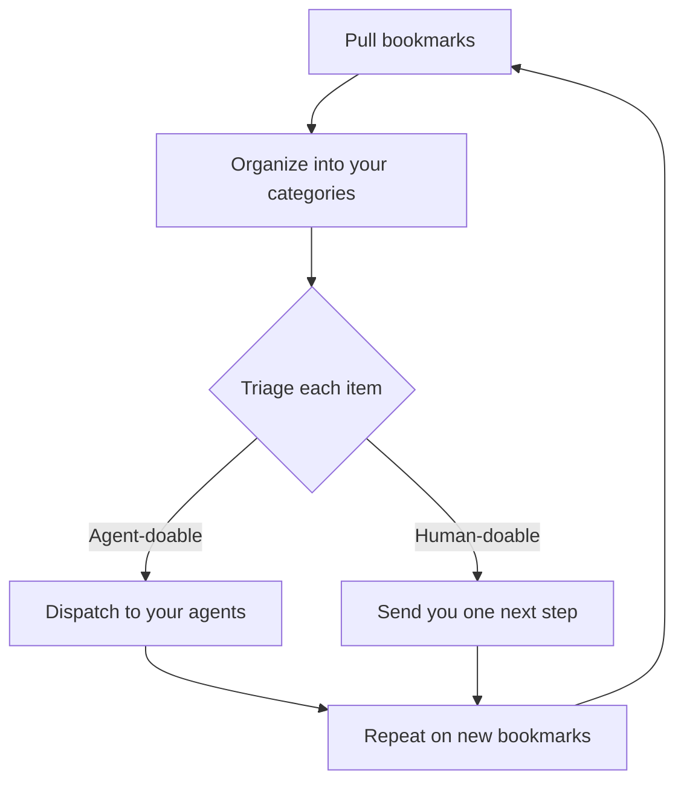

# Turn your bookmarks into action

This kit starts a repeating cycle. It pulls your bookmarks, organizes them into your own categories, triages each item as human-doable or agent-doable, dispatches agent-doable items to your agents so the learning is applied in everyday workflows, sends human-doable items to you with one next step, and repeats on new bookmarks.

## Quick start

Point your agent at this repo and say: run AGENT.md on my bookmarks.

Any agent that can read a repo can run the cycle (Claude, Codex, Cursor, Grok, or another). It will ask you to connect or export your bookmarks from X, your browser, or a read-later app, and to list the agents you want work sent to.

## Skills

`AGENT.md` calls these in order. Each skill is `skills/<name>/SKILL.md`. The top of the file says when to use it.

| Skill | What it does |
|---|---|
| `pull-bookmarks` | Fetch new bookmarks and skip anything already in the ledger. |
| `index-bookmarks` | Read each new bookmark in full and append it to the private library. |
| `triage-bookmarks` | Mark each item agent-doable or human-doable, with one next step. |
| `dispatch-to-agents` | Send agent-doable items to the user's agents and track status. |
| `weekly-bookmark-report` | Report what agents did and what needs the user. |
| `weekly-content-plan` | Propose 3–5 post ideas per chosen platform, each tied to a library entry. |
| `post-draft-check` | Check a draft against the library and suggest fixes that cite entry ids. |
| `weekly-content-review` | Record what worked in the user's private notes, not in a shared file. |

## Load the skills

A skill is a folder under `skills/` with one `SKILL.md`. The `name` matches the folder. The `description` says when to use it.

1. Point your agent at this repo, or copy `skills/` into the skills directory that agent already loads.
2. Say: run AGENT.md on my bookmarks.
3. The agent reads `AGENT.md`, then opens each skill file in order and follows it.

To run one skill, name the file. For example: run `skills/post-draft-check/SKILL.md` on this draft.

## What you get

All of these stay in your private workspace. They are not part of this repo.

- `my-skills.md`, categories named from your bookmarks.
- `agents.md` and `dispatch-queue.md`. Status is sent, applied, or needs human.
- A weekly action report, split into what agents did and what needs you.
- A weekly content plan, and `what-works-for-me.md` for what performed.

The cycle only dispatches reversible, low-risk work. It does not post, send, pay, sign up, or delete unless you tell it to.

## How to contribute

Open a pull request to improve `AGENT.md`, `skills/`, or `templates/`. Keep the change generic. Do not add names, handles, account details, bookmark exports, or categories taken from one person's saves.

Do not commit your own library, routing table, dispatch queue, reports, content plans, drafts, or `what-works-for-me.md`.
