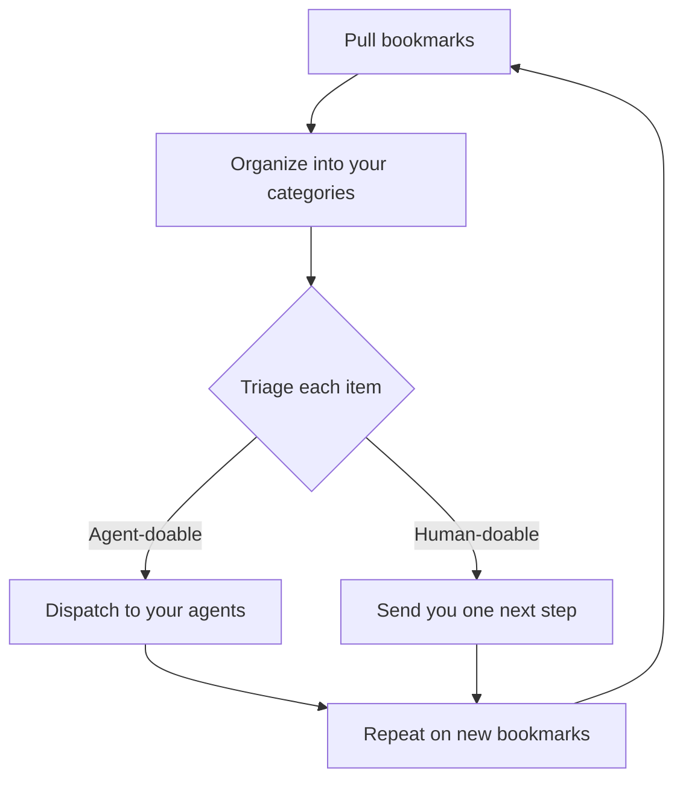

# Turn your bookmarks into action

This kit starts a repeating cycle. It pulls your bookmarks, organizes them into your own categories, triages each item as human-doable or agent-doable, dispatches agent-doable items to your agents so the learning is applied in everyday workflows, sends human-doable items to you with one next step, and repeats on new bookmarks.

## Quick start

Point your agent at this repo and say: run AGENT.md on my bookmarks.

Any agent that can read a repo can run the cycle (Claude, Codex, Cursor, Grok, or another). It will ask you to connect or export your bookmarks from X, your browser, or a read-later app, and to list the agents you want work sent to.

## What you get

- Your own skills library (`my-skills.md`): categories named from your bookmarks, and one entry per bookmark.
- A routing table (`agents.md`) and a dispatch queue (`dispatch-queue.md`). Each agent-doable item is sent to the agent that fits it. Status is sent, applied, or needs human.
- A weekly action report, split into what the agent did and what needs you, with a next step on each item that needs you.

The cycle only dispatches reversible, low-risk work. It does not post, send, pay, sign up, or delete unless you tell it to.

## How to contribute

Open a pull request to improve `AGENT.md` or the files in `templates/`. Keep the change generic. Do not add names, handles, account details, bookmark exports, or categories taken from one person's saves.

Do not commit your own `my-skills.md`, `agents.md`, dispatch queue, or reports.
